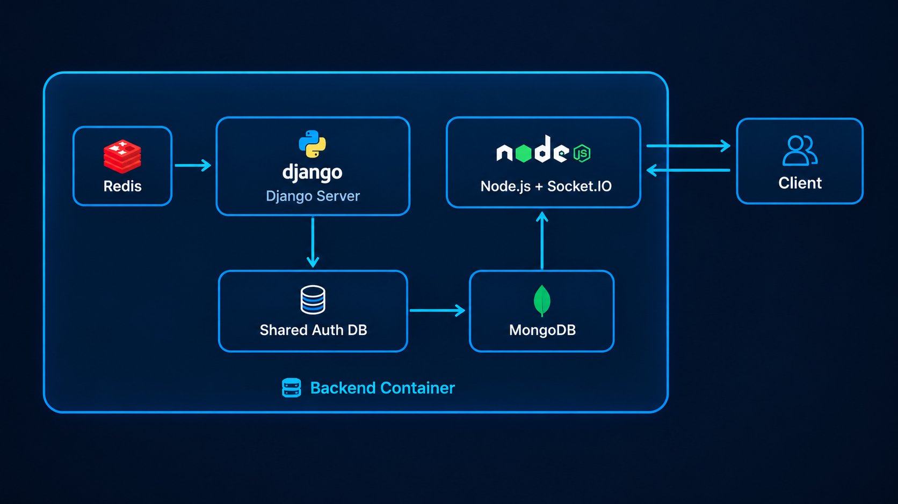

# Node.js WebSocket Service

A high-performance real-time WebSocket service built with Node.js and the `ws` library, running in Docker.

Part of the backend architecture illustrated in [../image.png](../image.png).

---

## Architecture Context



This service functions as the real-time bidirectional gateway between the **Client** and the backend data stores (**MongoDB** / **Redis**), complementing the **Django** REST server.

---

## Features

- **Low-Latency Duplex Communication:** WebSocket protocol on `ws://localhost:8080`.
- **Heartbeat & Dead Connection Cleanup:** Automatically pings clients every 30 seconds and terminates unresponsive connections.
- **Graceful Shutdown:** Handles `SIGINT` and `SIGTERM` signals for clean disconnection.
- **Docker Ready:** Includes a multi-stage, non-root `node:20-alpine` container configuration.

---

## Environment Variables

| Variable | Default | Description |
| :--- | :--- | :--- |
| `PORT` | `8080` | Port on which the WebSocket server listens |
| `NODE_ENV` | `production` | Environment mode (`development` or `production`) |
| `REDIS_URL` | `redis://redis:6379` | URL to Redis broker for Pub/Sub messaging |

---

## Running the Service

### Using Docker Compose (Recommended)
```bash
docker compose up -d
```

Check logs:
```bash
docker compose logs -f
```

Stop service:
```bash
docker compose down
```

### Running Locally (Without Docker)
```bash
npm install
npm start
```

---

## Testing Connection

You can test connectivity using Node.js:

```javascript
const WebSocket = require('ws');
const ws = new WebSocket('ws://localhost:8080');

ws.on('open', () => {
  console.log('Connected to WebSocket server');
  ws.send(JSON.stringify({ text: 'Hello Server!' }));
});

ws.on('message', (data) => {
  console.log('Received:', data.toString());
});
```
